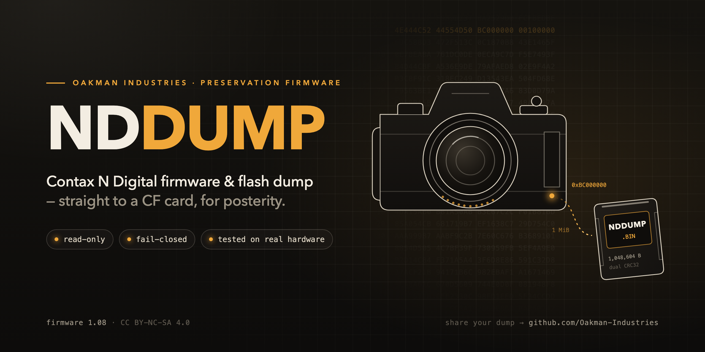

<p align="center">
  
</p>

# Contax N Digital — firmware & flash dump (NDDUMP)

**© 2026 Oakman Industries — licensed CC BY-NC-SA 4.0** (build on it, keep it open & non-commercial; see `LICENSE`).

A tiny custom firmware for the **Contax N Digital** that turns the camera's *Firmware Update* command into a
**read-only "dump my camera's flash to the CF card"** command. The result, `NDDUMP.BIN`, is a complete 1 MiB copy of the
camera's flash: its firmware **and** its stored settings/state. It's meant for backup and for preserving these cameras
before more of them die.

> [!WARNING]
> **Installing this firmware can permanently brick your camera.** Installing it goes through the camera's own stock
> updater, which erases and rewrites the flash. If power drops or the 20-year-old flash fails during that one step,
> the camera is gone. There is no recovery without opening the camera and attaching a flash programmer.
> **Once installed, the camera's firmware-update function is permanently replaced by the dump function.** You cannot
> go back to stock firmware, or install anything else, from the menu.
> Everything *after* the install (taking dumps) is read-only.
>
> It has been installed and used successfully on **one** real camera so far. That is encouraging, but it is not proof
> that it is safe for yours. Read the whole guide and decide for yourself.

> **❤️ Support more Contax N Digital work:** this is part of an ongoing effort to reverse-engineer and preserve the
> Contax N Digital (backups, calibration recovery, an open RAW developer). If it's useful to you, please consider
> supporting the work on **[Ko-Fi](https://ko-fi.com/oakman)**. Donations go directly toward hardware, testing and
> further research.

---

## Why this exists

The Contax N Digital (2002) is long discontinued. No service support remains, and every year more bodies fail. The
camera keeps its firmware, settings and running state in on-board flash. Until now there was no way to get a copy of
it out: FireWire only transfers images, and the camera's internal serial diagnostics aren't exposed on the body.
When a body dies, its flash contents die with it.

NDDUMP makes a full copy of that flash onto an ordinary CF card, so that:

- **you** have a backup of your own camera's flash, and
- **the community** can compare dumps across many bodies. That shows what is per-camera and what is common, where
  the settings live, and whether other firmware revisions ever existed. It preserves what these cameras actually ran.

**Please share your dumps** (see [Share your dump](#share-your-dump)). Every body that gets dumped is one more that
will never be fully lost.

> **Status:** community preservation firmware for a long-discontinued camera. The repo includes the original 1.08
> firmware and a ready-to-use patched copy. That firmware is © **Kyocera Corporation, which retains all rights**, and it
> is not covered by our license (see [`NOTICE`](NOTICE)).

---

## What's in this repo

| File | What it is |
|---|---|
| `cf-card/` | **Ready to use.** Copy its contents onto a CF card: the NDDUMP firmware (`D_CONTAX/100CXBOX/CXBRFIRM.BIN`) and the three empty `NDDUMP.RUN` marker files, in the exact layout that worked on a real camera. |
| `firmware/stock-1.08/CXBRFIRM.BIN` | The original, unmodified 1.08 firmware (© Kyocera Corporation, all rights retained), for reference and for building the patch yourself. |
| `firmware/nddump-fw108.ips` | The patch: turns a stock **1.08** `CXBRFIRM.BIN` into the NDDUMP firmware. Contains only the changed bytes. |
| `firmware/nd_lastresort.bin` | The compiled dump code (776 bytes), used when building the firmware yourself (Step 1, optional). |
| `firmware/src/` | Full C source, linker script and build script for that code. |
| `firmware/SHA256SUMS` | Hashes of the stock input, the patched output, the patch and the code blob. |
| `docs/DUMP_FORMAT.md` | Exactly what is inside `NDDUMP.BIN`, and how to check it. |

## Requirements

- A **Contax N Digital** that powers on, takes pictures and reads CF cards.
- A **fully charged battery and the AC adapter** (use both during the install).
- A **CF card the camera reads reliably**, formatted in the camera, and a card reader.
- A computer with `shasum`/`sha256sum`, `xxd` and `cmp` (built into macOS and Linux; on Windows use WSL or Git Bash).
  On Windows, `certutil -hashfile <file> SHA256` also works for the hash checks.

---

## Step-by-step

### Step 1 — Get the files and check the firmware hash

Download this repository (green **Code** button → *Download ZIP*, or `git clone`). Then check the firmware you are
about to flash. **This is the most important check in the whole guide:**

```bash
shasum -a 256 cf-card/D_CONTAX/100CXBOX/CXBRFIRM.BIN
# must be: c8deab4c8822fbf050b885b9c1422619b73920058177e9a1b88f4d23e63f211d   (746,540 bytes)
```

If it doesn't match, **stop**. Never flash a file whose hash you haven't confirmed.

<details>
<summary><b>Optional: build the NDDUMP firmware yourself instead of trusting ours</b></summary>

Start from the original 1.08 firmware: either `firmware/stock-1.08/CXBRFIRM.BIN` from this repo, or your own copy. The
official Windows update `Firm0108w.EXE` is a self-extracting archive that you can unpack without running it:
`tar -xf Firm0108w.EXE` gives `D_contax/100cxbox/CXBRFIRM.BIN`. Check the original first:

```bash
shasum -a 256 firmware/stock-1.08/CXBRFIRM.BIN
# must be: ea97198569531a8cf9d0e3f3e22c88b2e209e9dac3773daff33d1a698f635dfd
```

Then either apply `firmware/nddump-fw108.ips` with any IPS patcher (e.g. Floating IPS), or use `dd` to write the two
4-byte call redirects and the 776-byte dump code:

```bash
cp firmware/stock-1.08/CXBRFIRM.BIN CXBRFIRM.BIN
printf '\x0c\x02\x8b\x72' | dd of=CXBRFIRM.BIN bs=1 seek=$((0x386b0)) conv=notrunc
printf '\x0c\x02\x8b\x72' | dd of=CXBRFIRM.BIN bs=1 seek=$((0x38718)) conv=notrunc
dd if=firmware/nd_lastresort.bin of=CXBRFIRM.BIN bs=1 seek=$((0xa2eb0)) conv=notrunc
shasum -a 256 CXBRFIRM.BIN      # must be c8deab4c… exactly as above
```

Either way, the result must be byte-identical to `cf-card/D_CONTAX/100CXBOX/CXBRFIRM.BIN`.
</details>

### Step 2 — Prepare the CF card

Format the card **in the camera**, then copy **the contents** of the `cf-card/` folder (not the folder itself) onto the
card's root. The card must end up looking exactly like this, which is the layout that ran successfully on a real camera:

```
CF card (A:)
├── NDDUMP.RUN                  ← empty file (0 bytes)
└── D_CONTAX
    ├── NDDUMP.RUN              ← empty file (0 bytes)
    └── 100CXBOX
        ├── CXBRFIRM.BIN        ← the NDDUMP firmware (sha256 c8deab4c…)
        └── NDDUMP.RUN          ← empty file (0 bytes)
```

```bash
# macOS / Linux, with the card mounted at /Volumes/CARD (adjust the path):
cp -R cf-card/. /Volumes/CARD/
shasum -a 256 /Volumes/CARD/D_CONTAX/100CXBOX/CXBRFIRM.BIN   # check it again on the card
```

Notes:
- The dump code itself only looks for `A:\NDDUMP.RUN` in the card **root**. The two extra copies don't hurt, and we
  recommend copying the proven layout exactly.
- The stock firmware ignores the `NDDUMP.RUN` files, so the same card works for both the install and the dumps.
- Leave `CXBRFIRM.BIN` on the card for the dump step too. The camera's update menu works from it.
- Don't leave an old `NDDUMP.BIN` in the root. The firmware refuses to overwrite an existing dump.

### Step 3 — Install (the one risky step)

1. Insert the full battery **and** connect the AC adapter.
2. Insert the card and run the camera's firmware update from the menu (**UPDATE SOFTWARE?**). Confirm it.
3. **Do not touch anything** until the update has finished and the camera has restarted: no buttons, no card removal,
   no power interruption.

The camera now runs 1.08 + NDDUMP. It shoots, reviews and transfers images as before. Its firmware-update command is
now the dump command and will never flash again.

### Step 4 — Take a dump (read-only, safe)

1. With the same card in, run the firmware update from the menu again.
2. Because `NDDUMP.RUN` is on the card, the firmware writes the flash to **`A:\NDDUMP.BIN`** instead of updating. It
   does not flash anything. Give it time, and wait until card activity has stopped before removing the card.
3. Copy `NDDUMP.BIN` to your computer. It should be exactly **1,048,604 bytes**.

If there is no `NDDUMP.RUN` in the root, the command simply does nothing. If an `NDDUMP.BIN` already exists, it does
nothing too. Rename or move the old one off the card first (e.g. `NDDUMP_1.BIN`), then dump again.

> We haven't documented yet what the camera's screen shows during and after a dump. Please tell us what you see
> (see [Contributing](#contributing)).

### Step 5 — Check the dump

```bash
ls -l NDDUMP.BIN                 # 1048604 bytes
xxd -l 16 NDDUMP.BIN
# 00000000: 4e44 4c52 4455 4d50 bc00 0000 0010 0000  NDLRDUMP........
tail -c 12 NDDUMP.BIN | xxd
# 00000000: XXXX XXXX XXXX XXXX 0010 0000            ← the first two 4-byte values must be EQUAL
```

**Take at least two dumps** (rename the first, dump again) and compare the firmware part. It must be identical:

```bash
cmp -n 720912 NDDUMP_1.BIN NDDUMP_2.BIN && echo "firmware region identical — good"
```

The rest of the file is *expected* to differ between dumps. That part holds the clock, counters and a log of recent
captures, which change as you use the camera. See [`docs/DUMP_FORMAT.md`](docs/DUMP_FORMAT.md) for details and for a
known quirk with the stored CRC.

### Step 6 — Keep it safe, and share it

Keep several copies of your verified dumps in different places. Then please [share it](#share-your-dump).

---

## How it works (brief)

- The stock firmware's update command calls one update routine from two places. NDDUMP rewrites those two calls
  (file offsets `0x386B0` and `0x38718`) to point at a small gate routine. The gate lives in a 1,328-byte all-zero
  region of the stock image (file offset `0xA2EB0`, runtime address `0x800A2DC8`). Nothing else in the firmware
  changes.
- The **gate** checks for `A:\NDDUMP.RUN`. If it's present, it calls the dumper. If not, it returns and does nothing.
  It **never** calls the original updater (fail-closed).
- The **dumper** reads the 1 MiB flash window at `0xBC000000` as plain memory. It never sends a flash erase/program
  command. It writes the window to a new `A:\NDDUMP.BIN` using the camera's own file routines, with a header, a CRC32
  taken while writing, and a second CRC32 from an independent re-read.
- The full source is in `firmware/src/nd_lastresort.c` (about 100 lines of C). `firmware/src/build.sh` rebuilds the
  blob with a MIPS cross-compiler (`gcc-mips-linux-gnu`). The released `nd_lastresort.bin` is the exact binary that was
  flashed and tested, SHA-256 `602d0b61…`. A rebuild with a different compiler version may not be byte-identical.

## Accuracy & limitations

Honest status. Please help close these gaps.

- **Real-world testing: one camera.** One body was flashed, booted normally, kept working as a camera, and produced
  repeated dumps. The firmware region was byte-identical across all four dumps. That's one success, not a safety
  record.
- **The install risk is real and can't be engineered away here.** Before release, the patch was checked thoroughly in
  emulation: the patched firmware boots like stock, the dumper never writes flash, and only two flash blocks differ
  from stock. But the stock updater still erases and rewrites flash, including the boot area, and nothing can protect
  against a power or hardware failure during that.
- **The install is one-way.** After it, the menu can't update the firmware any more, not even back to stock.
- **Only a 1.08-based build is provided.** Installing it replaces the whole firmware, so a camera currently on 1.07
  ends up on 1.08 + NDDUMP. This hasn't been tested on a body that started on 1.07.
- **The stored CRC doesn't match a CRC computed on the computer.** The camera's two internal CRCs always agree with
  each other (stable read), but recomputing CRC32 over the dumped data on a PC gives a different value. The cause
  isn't known yet. Until it is, check dumps by comparing two dumps' firmware region (Step 5).
- **"1 MiB" is the window we dump, not a confirmed chip size.** Dumps capture firmware, settings and live state. It
  isn't yet proven that this is *every* byte of non-volatile storage in the camera. Some parts of the camera (e.g. the
  body/lens controllers) have their own chips, which this does **not** dump.
- **Restoring a dump to a camera is not supported.** This is a backup/preservation copy, not a restore image.
- **CCD calibration:** on the camera tested, the block once suspected to hold CCD calibration was empty. That fits the
  calibration having lived only on the camera's *CCD Parameter Disc*. If your disc is lost, see our
  [ccd-disc-recreator](https://github.com/Oakman-Industries/ccd-disc-recreator).

## Share your dump

Dumps from many bodies are what make this valuable for preservation. If you've made one, please
**[open a "Share a dump" issue](../../issues/new?template=share-a-dump.yml)** with:

- the SHA-256 of each `NDDUMP.BIN`, and the Step 5 check output;
- the firmware version the camera showed **before** you installed NDDUMP;
- anything notable: what the screen showed, how long it took, any errors;
- a **download link** to the dump(s) hosted wherever you like (a cloud drive or archive). **Please don't commit dumps
  into this repository.**

**Privacy:** a dump contains your camera's settings, its date/time, and a log of recent image file names and
timestamps. No camera serial number appeared in plain text in the dumps we examined, but we can't promise that for
every body. Only share what you're comfortable with. You may leave out the serial number entirely.

Even if you can't share the file, posting the hashes and your experience (including a failed install) is valuable.

## Contributing

See **[CONTRIBUTING.md](CONTRIBUTING.md)**. Contributions are released under the same **CC BY-NC-SA 4.0** license.
Keep your findings open and non-commercial. Apart from the 1.08 files listed in `NOTICE`, please don't submit
Kyocera/Contax firmware or software to this repo. Share dumps by link.

## Legal / ethical

By **Oakman Industries**, for owners preserving their **own** discontinued cameras. This is interoperability and
preservation work for long-abandoned hardware.

**Original firmware:** `firmware/stock-1.08/CXBRFIRM.BIN` and the patched `cf-card/D_CONTAX/100CXBOX/CXBRFIRM.BIN`
contain the Contax N Digital 1.08 firmware, **copyright Kyocera Corporation, which retains all rights to it**. It is
included only so owners can back up and preserve their own cameras. It is **not** licensed under CC BY-NC-SA 4.0,
and Oakman Industries claims no ownership of it and is not affiliated with or endorsed by Kyocera Corporation. Full
details are in [`NOTICE`](NOTICE). Rights holders with a concern, please open an issue.

You use this entirely at your own risk; see the warning at the top and the disclaimer in `LICENSE`.

## Support

❤️ **Support the project:** [ko-fi.com/oakman](https://ko-fi.com/oakman)

NDDUMP is one piece of a larger Contax N Digital preservation project (firmware backup, calibration recovery, and an
open RAW developer). Contributions fund the hardware, test cameras, media and time that keep it going, and help bring
more of these cameras back to life.

## License

**CC BY-NC-SA 4.0** (Oakman Industries' own work only; the Kyocera firmware files are excluded, see `NOTICE`).
Copyright © 2026 **Oakman Industries**. You may use, study, modify and build on this work (code
*and* the research/findings it embodies), but you must: **credit Oakman Industries**, **release your derivatives and
your own findings openly under the same license**, and **not use it commercially**. Full text in `LICENSE`.
(Deliberately copyleft + non-commercial, so improvements stay open to the community. Because of the NonCommercial
clause this is intentionally not an OSI "open source" license.)
